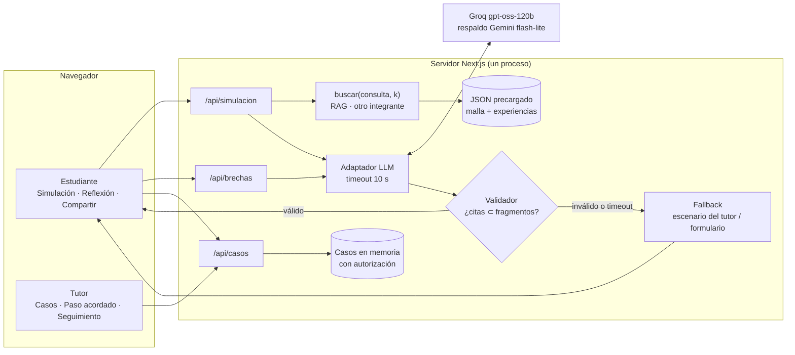
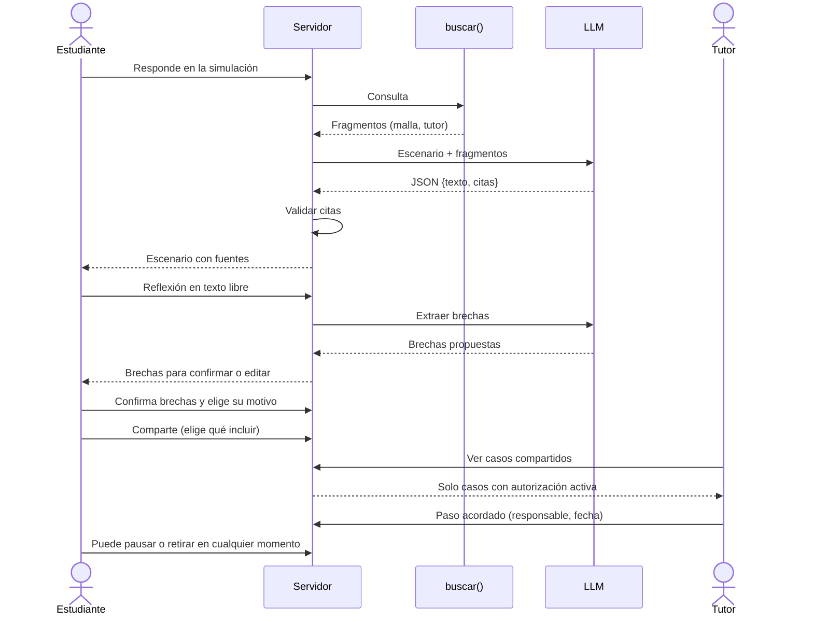
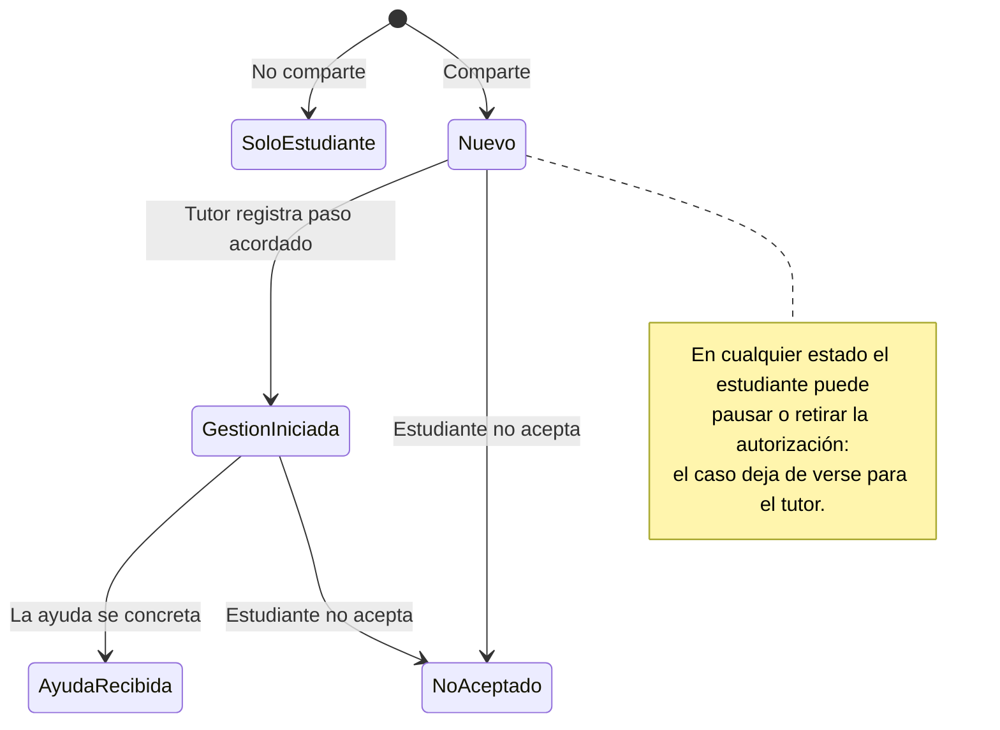

# Diseño del MVP · Simulación de carrera + acompañamiento

Complementa [planificacion.md](planificacion.md). Listo para implementar en Next.js +
TypeScript + Tailwind. Datos ficticios; el selector de rol **no es autenticación**.
El RAG lo implementa otro integrante; aquí solo se fija su contrato (§5).

## 1. Estilo

- Pensado para proyector: texto base 18 px, títulos grandes, alto contraste.
- Fondo neutro, **un** color de acento (p. ej. teal) para acciones; ámbar solo para
  rótulos de «Simulación» y «Demo». Sin rojo de alerta: nada aquí es un diagnóstico.
- Cada pantalla tiene un único botón principal. Etiquetas visibles en todos los
  campos; todo operable con teclado.

## 2. Rutas y recorrido

```
/                  Selector de rol  [Estudiante] [Tutor]        (banda "DEMO · datos ficticios")
/estudiante        Paso 1 Simulación → Paso 2 Reflexión → Paso 3 Compartir
/tutor             Casos compartidos (solo con autorización activa)
/tutor/[id]        Detalle + paso acordado + seguimiento
```

## 3. Pantallas

### 3.1 Estudiante · Paso 1: Simulación

```
┌ DEMO · datos ficticios ───────────────────────── Rol: Estudiante ▾ ┐
│ ① Simulación ── ② Reflexión ── ③ Compartir                          │
│ ┌ SIMULACIÓN ───────────────────────────────────────────────────┐   │
│ │ Basada en la experiencia de «Tutor ficticio» y en la malla de │   │
│ │ <Carrera>. Es la experiencia de una persona, no de toda la    │   │
│ │ carrera.                                                       │   │
│ └────────────────────────────────────────────────────────────────┘   │
│  IA: Es martes, 3er semestre. En <Ramo> te toca ...                 │
│      Fuente: malla · <Ramo>   |   experiencia del tutor #1          │
│  Tú: ...                                                            │
│ [ Escribe cómo reaccionarías...                         ] [Enviar] │
│ Escenario 1 de 3                         [Terminar simulación →]    │
└─────────────────────────────────────────────────────────────────────┘
```

- Las citas son chips con el `id` del fragmento; al pasar el cursor muestran el texto.
- Si la IA falla o tarda >10 s: «La IA no respondió a tiempo. Puedes seguir con el
  escenario escrito por el tutor.» y se muestra el texto del escenario sin IA.

### 3.2 Estudiante · Paso 2: Reflexión

```
│ ¿Qué esperabas de tu carrera? ¿Qué te sorprendió de la simulación?  │
│ [ texto libre ...                                                ]  │
│                                   [Ver qué noté →]                  │
│ Brechas que la IA propone (tú decides):                             │
│  ☑ Esperabas: más práctica   · La simulación mostró: mucha teoría   │
│    Fuente: malla · <Ramo>         [Editar] [Descartar]              │
│ ¿Qué pesó más al elegir esta carrera? (varias o ninguna)            │
│  [Gusto] [Empleabilidad] [Presión de otros] [Otro: ____]            │
│                                          [Continuar →]              │
```

- Solo pasan al resumen las brechas **confirmadas o editadas** por el estudiante.
- El motivo lo marca el estudiante; la IA nunca lo sugiere ni lo infiere.

### 3.3 Estudiante · Paso 3: Compartir

```
│ Tu resumen                                                          │
│  • Brechas confirmadas (2)   • Motivo: Gusto, Presión de otros      │
│ ¿Quieres compartirlo con tu tutor?                                  │
│  Elige qué incluir: ☑ Brechas  ☐ Motivo                             │
│  Puedes pausarlo o retirarlo cuando quieras. Si no compartes,       │
│  nada cambia y nadie más lo verá.                                   │
│  [Compartir con mi tutor]     [No, guardarlo solo para mí]          │
│ Estado: Compartido · [Pausar] [Retirar autorización]                │
```

- El motivo viene **desmarcado** por defecto (la presión familiar es sensible).
- Retirar oculta el caso al tutor de inmediato.

### 3.4 Tutor · Lista y detalle

```
/tutor
│ Casos compartidos contigo                                           │
│  Estudiante A (ficticio) · <Carrera> · 2 brechas · Gestión iniciada │
│  Estudiante B (ficticio) · <Carrera> · 1 brecha  · Nuevo            │

/tutor/[id]
│ Esto lo declaró el estudiante. No es un diagnóstico.                │
│  Brechas: ...  (con su fuente)      Motivo: (solo si lo compartió)  │
│ Siguiente paso acordado                                             │
│  Acción [ Conversar con estudiante de 3er año      ▾ ]              │
│  Responsable [ ______ ]   Fecha [ __/__/____ ]   [Registrar]        │
│ Notas del tutor (no modifican lo que declaró el estudiante) [____]  │
│ Seguimiento: Nuevo → Gestión iniciada → Ayuda recibida              │
│              (o: El estudiante pausó / retiró / no aceptó)          │
```

Acciones sugeridas en el desplegable (texto libre también): orientación vocacional,
conversar con estudiante de curso superior, conversar con docente del ramo,
información sobre cambio de carrera. Cambiarse de carrera también es un buen resultado.

## 4. Tipos

```ts
type Fragmento = { id: string; tipo: "malla" | "tutor"; texto: string; fuente: string };
type Mensaje   = { rol: "ia" | "estudiante"; texto: string; citas?: string[] };
type Brecha    = { id: string; esperaba: string; mostro: string; citas: string[];
                   estado: "propuesta" | "confirmada" | "editada" | "descartada" };
type Motivo    = "gusto" | "empleabilidad" | "presion" | "otro";
type Paso      = { accion: string; responsable: string; fecha: string; nota?: string };
type Caso = {
  id: string; alias: string; carrera: string;
  brechas: Brecha[];                       // solo confirmadas/editadas
  motivos?: Motivo[]; motivoOtro?: string; // solo si el estudiante lo incluyó
  autorizacion: "activa" | "pausada" | "retirada";
  estado: "nuevo" | "gestion_iniciada" | "ayuda_recibida" | "no_aceptado";
  pasos: Paso[];
};
```

Estado en memoria del servidor (se pierde al reiniciar). Botón «Reiniciar demo» solo en `/`.

## 5. Contratos internos

| Handler | Entrada | Salida |
| --- | --- | --- |
| `POST /api/simulacion` | `{ historial: Mensaje[], mensaje, escenario }` | `{ texto, citas[] }` o `{ fallback: true, motivo: "timeout" \| "invalido" }` |
| `POST /api/brechas` | `{ textoLibre, historial }` | `{ brechas: Brecha[] }` (estado `propuesta`) |
| `POST /api/casos` | resumen confirmado + qué incluir | `Caso` |
| `GET /api/casos` | — | casos con `autorizacion = "activa"` |
| `PATCH /api/casos/[id]` | `{ paso? , estado?, autorizacion? }` | `Caso` |

- **RAG (lo implementa el otro integrante):**
  `buscar(consulta: string, k: number): Promise<Fragmento[]>`. Mientras no exista,
  usar un `buscar` simulado que devuelve fragmentos fijos del JSON.
- **Validador:** toda cita debe ser un `id` presente en los fragmentos recuperados para
  esa llamada; si no, se descarta la respuesta y se usa el fallback.
- **Autorización:** el servidor vuelve a comprobar `autorizacion` en cada lectura del
  tutor; retirada o pausada ⇒ el caso no se entrega.
- **Respuestas tardías:** cada llamada lleva un `requestId`; si llega después del
  timeout o de un cambio de paso, se descarta.

## 6. Contenido (JSON precargado)

```json
{
  "carrera": { "nombre": "<Carrera>", "fuente": "<URL malla pública o 'ficticia'>" },
  "malla": [
    { "id": "malla:<COD>", "semestre": 3, "nombre": "<Ramo>", "descripcion": "..." }
  ],
  "experiencias": [
    { "id": "tutor:exp-1", "autor": "Tutor ficticio (demo)", "rol": "<Rol>",
      "escenarios": [ { "id": "tutor:exp-1#1", "ramoId": "malla:<COD>", "texto": "..." } ] }
  ]
}
```

Un archivo para la carrera elegida; 2–3 escenarios de ramos de 2º–3º semestre.

## 7. Textos fijos

- Banda global: «DEMO · datos ficticios · selector de rol sin autenticación».
- Rótulo de simulación: «Es la experiencia de una persona, no de toda la carrera».
- Tutor: «Esto lo declaró el estudiante. No es un diagnóstico».
- Fallback: «La IA no respondió a tiempo. Puedes seguir con el escenario escrito por el tutor».

## 8. Diagramas

### 8.1 Componentes



### 8.2 Recorrido de la demo



### 8.3 Estados del caso


