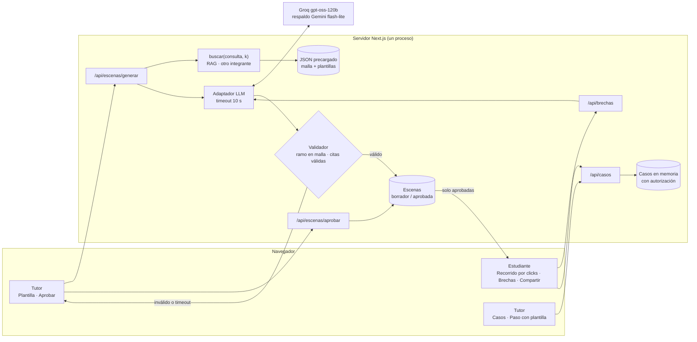
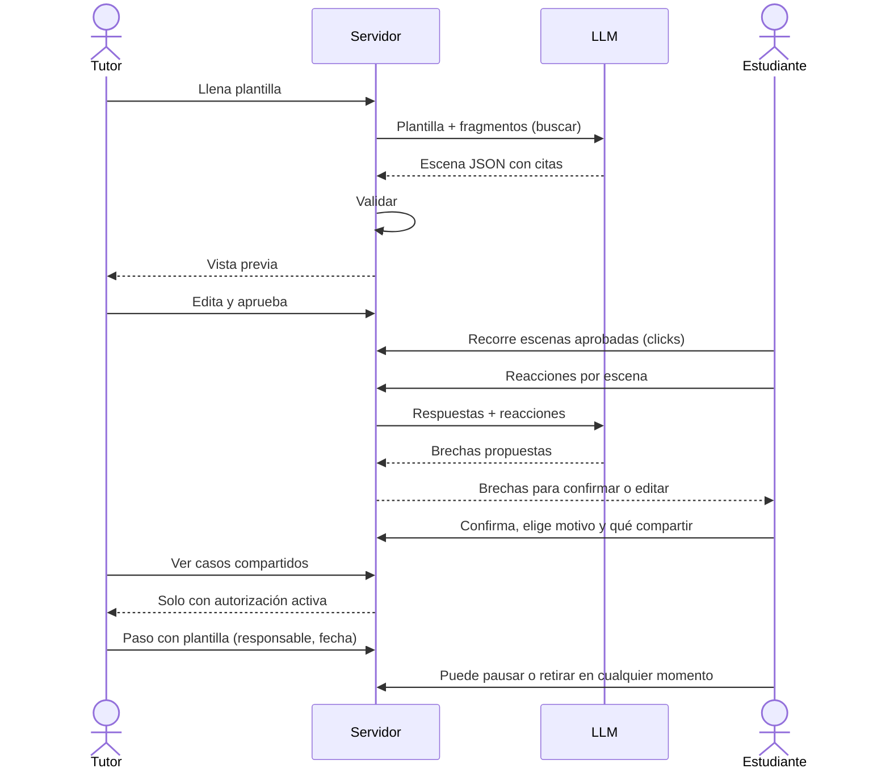
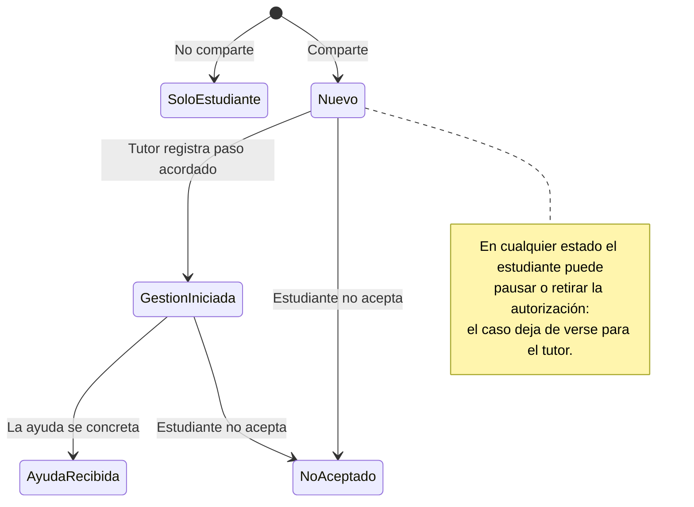

# Diseño del MVP · Simulación de carrera + acompañamiento (v2)

v2 (6/11 ~11:55): la simulación pasa a ser un **recorrido audiovisual por clicks** y el
tutor crea contenido con **plantillas**. Reemplaza el chat de v1 y el §2, la fila P0 y
el §5 de [planificacion.md](planificacion.md). Next.js + TypeScript + Tailwind. Datos
ficticios; el selector de rol **no es autenticación**. El RAG lo implementa otro
integrante; aquí solo se fija su contrato (§7).

## 1. Idea en una línea

El tutor llena una plantilla con su experiencia → **la IA la convierte en escenas
interactivas** citando malla y plantilla → el tutor revisa y aprueba → el estudiante
recorre las escenas con clicks y marca qué le sorprendió → la IA propone brechas, el
estudiante confirma y decide si comparte → el tutor acuerda un paso con plantilla.

## 2. Mecánica: juego de decisiones (sin puntaje)

- Cada escena plantea una situación real del ramo y **¿qué harías?** con 3 opciones.
- Cada decisión muestra **lo que suele pasar** (según la experiencia del tutor) y puede
  **ramificar**: la opción indica la escena siguiente (`siguiente`), así dos estudiantes
  pueden vivir recorridos distintos.
- **No hay puntaje, vidas, «ganar» ni «perder», ni respuestas correctas.** El juego
  muestra la carrera, no evalúa a la persona; un medidor de «aptitud» sería perfilar.
- Pantalla final **«Tu recorrido»**: línea de tiempo con las decisiones tomadas y las
  reacciones marcadas (😀 😮 🙁), que alimenta la propuesta de brechas.
- Ritmo: 3 escenas en la demo (≈35 s); cada escena se juega en ≤15 s.

## 3. Estilo audiovisual (sin assets externos)

- Escenas a pantalla completa, una por vez, con transición suave (fade/slide).
- Cada escena: fondo de color por tipo (clase, laboratorio, prueba, práctica, trabajo
  en equipo), ícono/emoji grande, encabezado «3er semestre · Semana 6 · <Ramo>».
- **🔊 Escuchar:** narración con la Web Speech API del navegador (`speechSynthesis`,
  voz es-CL/es-ES). Solo narra contenido del tutor, nunca texto del estudiante.
- Línea de tiempo arriba (Sem 1 → Sem 2 → Sem 3) y barra «Escena 2 de 3».
- Proyector: texto base 18 px, alto contraste, un color de acento. Ámbar solo para
  rótulos «Simulación» y «Demo». Sin rojo de alerta: nada es un diagnóstico.
- Todo operable con teclado (1/2/3 para opciones, Enter para seguir).

## 4. Rutas

```
/                    Selector de rol [Estudiante] [Tutor] · banda «DEMO · datos ficticios»
/tutor/plantilla     Llenar plantilla → Generar con IA → Revisar → Aprobar
/estudiante          Recorrido por escenas → Reacciones → Brechas → Compartir
/tutor               Casos compartidos (solo con autorización activa)
/tutor/caso/[id]     Detalle + paso acordado con plantilla + seguimiento
```

## 5. Pantallas

### 5.1 Tutor · Plantilla de escena

```
│ Plantilla de escena                                    (DEMO)       │
│ Ramo         [ <Ramo> (de la malla) ▾ ]   Momento [ 3er sem · S6 ▾ ]│
│ Tipo         [ Clase ] [ Laboratorio ] [ Prueba ] [ Práctica ]      │
│ Situación típica (tus palabras)                                     │
│ [ Te pasan un caso de costos con datos incompletos y ...         ]  │
│ ¿Qué suele sorprender a los de primer año?                          │
│ [ Que es más Excel y análisis que contabilidad "de libro" ...     ]  │
│ ¿Qué hace quien le va bien?                                         │
│ [ Pregunta temprano, arma grupo de estudio ...                    ]  │
│ Tu rol (sin nombre si prefieres) [ Titulada 2022, hoy tutora ]      │
│                                   [✨ Generar escena con IA]        │
│ Vista previa ─ escena + 3 opciones + «lo que suele pasar»           │
│   Fuentes: malla · <Ramo>  |  plantilla #1                          │
│                        [Editar]  [Aprobar y publicar]               │
```

Solo las escenas **aprobadas** llegan al estudiante. Rótulo en la escena publicada:
«Generada con IA a partir de la experiencia de <rol> y revisada por esa persona.
Es la experiencia de una persona, no de toda la carrera.»

### 5.2 Estudiante · Recorrido

```
│ Sem 1 ─── Sem 2 ─── ● Sem 3                     Escena 2 de 3  🔊   │
│                         🧪                                          │
│        3er semestre · Semana 6 · <Ramo> · Laboratorio               │
│  Te pasan un caso con datos incompletos y una hora para entregar... │
│  ¿Qué harías?                                                       │
│   [1] Pido los datos que faltan al profe                            │
│   [2] Hago supuestos y los explico                                  │
│   [3] Espero a que el grupo lo resuelva                             │
```

Tras elegir:

```
│  Lo que suele pasar: ... (texto de la escena)                       │
│  Fuente: malla · <Ramo> | experiencia de <rol>                      │
│  ¿Esto es lo que imaginabas de tu carrera?                          │
│   [😀 Sí, así lo imaginaba] [😮 Me sorprendió] [🙁 No me gustó]     │
│                                             [Siguiente escena →]    │
```

### 5.3 Estudiante · Brechas y motivo

```
│ Según lo que marcaste, esto podría no calzar con lo que esperabas:  │
│  ☑ Imaginabas <X>; en 3er semestre <Ramo> es <Y>.  (Escena 2)       │
│      [Editar] [Descartar]                                           │
│ ¿Quieres agregar algo? (opcional) [ ...                          ]  │
│ ¿Qué pesó más al elegir esta carrera? (varias o ninguna)            │
│  [Gusto] [Empleabilidad] [Presión de otros] [Otro: ____]            │
│                                              [Continuar →]          │
```

El motivo lo marca el estudiante; la IA nunca lo sugiere ni lo infiere.

### 5.4 Estudiante · Compartir

```
│ ¿Quieres compartir tu resumen con tu tutor?                         │
│  Elige qué incluir: ☑ Brechas  ☐ Motivo                             │
│  Puedes pausarlo o retirarlo cuando quieras. Si no compartes,       │
│  nada cambia y nadie más lo verá.                                   │
│  [Compartir con mi tutor]     [No, guardarlo solo para mí]          │
│ Estado: Compartido · [Pausar] [Retirar autorización]                │
```

El motivo viene **desmarcado** por defecto (la presión familiar es sensible).

### 5.5 Tutor · Caso con plantillas de seguimiento

```
│ Esto lo declaró el estudiante. No es un diagnóstico.                │
│ Brechas (con escena y fuente)      Motivo: (solo si lo compartió)   │
│ Plantilla de siguiente paso:                                        │
│  [Conversación 1:1] [Hablar con estudiante de 3er año]              │
│  [Orientación vocacional] [Info cambio de carrera] [Otra]           │
│  → precarga: acción, responsable sugerido y mensaje editable        │
│  Responsable [ ____ ]  Fecha [ __/__ ]            [Registrar]       │
│ Notas del tutor (no modifican lo que declaró el estudiante) [___]   │
│ Seguimiento: Nuevo → Gestión iniciada → Ayuda recibida              │
│              (o: El estudiante pausó / retiró / no aceptó)          │
```

Cambiarse de carrera también es un buen resultado.

## 6. Tipos

```ts
type Fragmento = { id: string; tipo: "malla" | "plantilla"; texto: string; fuente: string };
type Plantilla = { id: string; ramoId: string; momento: string; tipo: TipoEscena;
                   situacion: string; sorprende: string; leVaBien: string; rolAutor: string };
type TipoEscena = "clase" | "laboratorio" | "prueba" | "practica" | "equipo";
type Opcion    = { id: string; texto: string; loQueSuelePasar: string; siguiente?: string }; // id de escena
type Escena    = { id: string; plantillaId: string; ramoId: string; momento: string;
                   tipo: TipoEscena; titulo: string; narracion: string;
                   opciones: Opcion[]; citas: string[];
                   estado: "borrador" | "aprobada" };
type Reaccion  = "imaginaba" | "sorprendio" | "no_gusto";
type Respuesta = { escenaId: string; opcionId: string; reaccion: Reaccion };
type Brecha    = { id: string; texto: string; escenaId: string; citas: string[];
                   estado: "propuesta" | "confirmada" | "editada" | "descartada" };
type Motivo    = "gusto" | "empleabilidad" | "presion" | "otro";
type Paso      = { plantilla: string; accion: string; responsable: string; fecha: string; nota?: string };
type Caso = {
  id: string; alias: string; carrera: string;
  brechas: Brecha[];                       // solo confirmadas/editadas
  motivos?: Motivo[]; motivoOtro?: string; // solo si el estudiante lo incluyó
  autorizacion: "activa" | "pausada" | "retirada";
  estado: "nuevo" | "gestion_iniciada" | "ayuda_recibida" | "no_aceptado";
  pasos: Paso[];
};
```

Estado en memoria del servidor. Botón «Reiniciar demo» solo en `/`.

## 7. IA y contratos internos

**Dos llamadas de IA:**

1. **Plantilla → escena** (`POST /api/escenas/generar`). Entrada: plantilla + fragmentos
   de `buscar()`. Salida JSON: `Escena` en `borrador` con 3 opciones y citas. La IA
   redacta y dramatiza; no agrega hechos que no estén en la plantilla o la malla.
2. **Respuestas → brechas** (`POST /api/brechas`). Entrada: escenas recorridas +
   respuestas + texto opcional. Salida JSON: brechas `propuesta`, cada una ligada a una
   escena marcada «me sorprendió» o «no me gustó».

| Handler | Salida |
| --- | --- |
| `POST /api/escenas/generar` | `Escena` (borrador) o `{ fallback: true }` |
| `POST /api/escenas/[id]/aprobar` | `Escena` aprobada (con ediciones del tutor) |
| `GET /api/escenas` | solo escenas `aprobada` |
| `POST /api/brechas` | `{ brechas: Brecha[] }` o `{ fallback: true }` |
| `POST /api/casos` · `GET /api/casos` · `PATCH /api/casos/[id]` | como v1 |

- **RAG (otro integrante):** `buscar(consulta: string, k: number): Promise<Fragmento[]>`.
  Mientras no exista, un `buscar` simulado devuelve fragmentos fijos del JSON.
- **Validador:** `ramoId` debe existir en la malla; toda cita debe estar entre los
  fragmentos recuperados; 3 opciones no vacías. Si falla, se descarta.
- **Fallbacks (timeout 10 s):** generación → el tutor ve un formulario para escribir la
  escena a mano. Brechas → regla fija: cada escena marcada «sorprendió/no me gustó»
  genera una brecha con el texto «qué suele sorprender» de su plantilla.
- **Revisión humana:** ninguna escena generada llega al estudiante sin aprobación.
- **Autorización:** el servidor comprueba `autorizacion` en cada lectura del tutor.
- **Respuestas tardías:** cada llamada lleva `requestId`; si llega tarde, se descarta.

## 8. Contenido precargado

```json
{
  "carrera": { "nombre": "<Carrera>", "fuente": "<URL malla pública o 'ficticia'>" },
  "malla": [ { "id": "malla:<COD>", "semestre": 3, "nombre": "<Ramo>", "descripcion": "..." } ],
  "plantillas": [ { "id": "plantilla:1", "ramoId": "malla:<COD>", "momento": "3er sem · S6",
                    "tipo": "laboratorio", "situacion": "...", "sorprende": "...",
                    "leVaBien": "...", "rolAutor": "Tutor ficticio (demo)" } ],
  "escenas": [ "2 escenas ya aprobadas, generadas antes con la llamada 1" ]
}
```

En la demo se genera **una** escena en vivo desde una plantilla; las otras dos vienen
aprobadas de antes, para no depender de la IA en todo el recorrido.

## 9. Guion de demo de 90 s (propuesta, reemplaza §2 de planificacion.md)

| Seg. | Qué se ve |
| --- | --- |
| 0–20 | Tutor: plantilla llena → ✨ Generar con IA → vista previa con fuentes → Aprobar |
| 20–55 | Estudiante: 3 escenas por clicks, 🔊 en una, reacciones con emojis |
| 55–68 | Brechas propuestas → confirma una, edita otra; marca su motivo |
| 68–78 | Comparte solo brechas (motivo desmarcado) |
| 78–90 | Tutor: caso → plantilla «Hablar con estudiante de 3er año» → gestión iniciada |

## 10. Textos fijos

- Banda: «DEMO · datos ficticios · selector de rol sin autenticación».
- Escena: «Generada con IA a partir de la experiencia de <rol> y revisada por esa
  persona. Es la experiencia de una persona, no de toda la carrera».
- Tutor: «Esto lo declaró el estudiante. No es un diagnóstico».
- Fallback: «La IA no respondió a tiempo. Puedes escribir la escena a mano».

## 11. Diagramas

### 11.1 Componentes



### 11.2 Recorrido



### 11.3 Estados del caso


